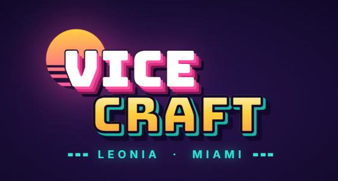
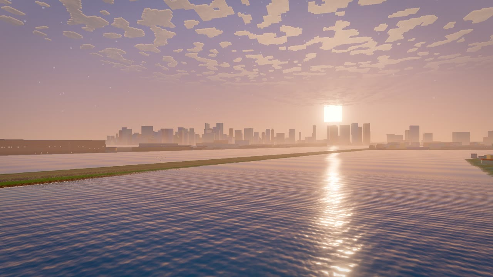
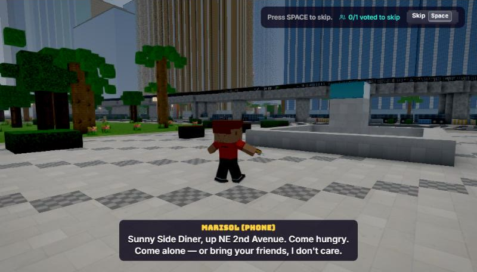
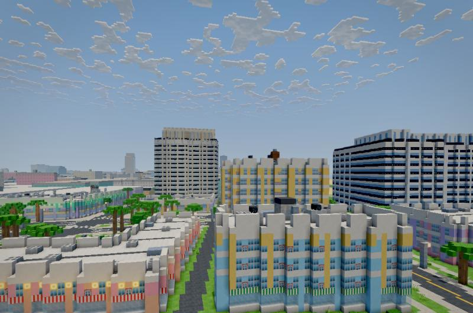
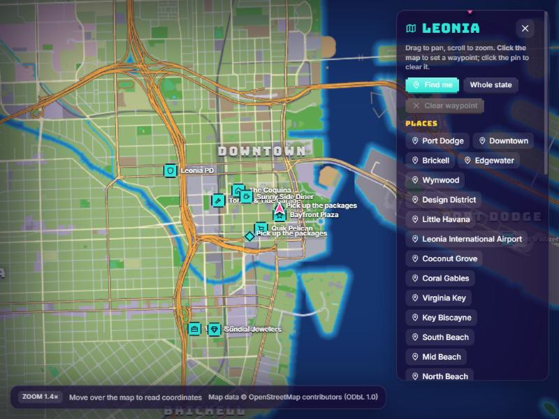
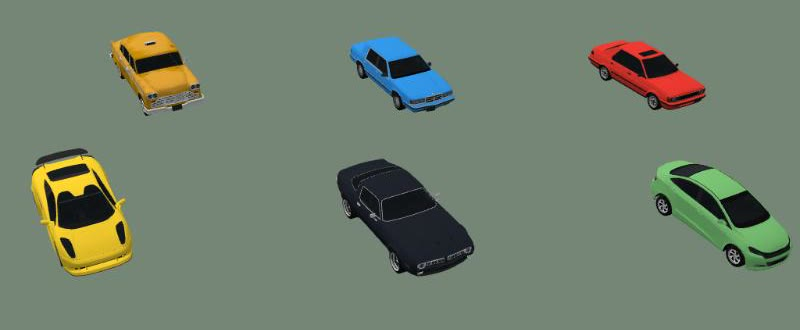

<p align="center"></p>

<p align="center"><b>A blocky multiplayer open world in your browser.</b><br>Drive, run heists and race with friends across Leonia, a block-by-block Miami.</p>

<p align="center"><a href="https://vice-craft.vercel.app"><b>▶ Play now</b></a></p>



## What's in it

- **Real Miami, in blocks.** Downtown, Brickell, Wynwood, South Beach and more, built from OpenStreetMap.
- **Online with friends.** Lobbies of up to 16, parties of 4, 5-digit friend codes. No sign-up needed.
- **Story, heists, mini-games.** 8 story missions, 3 multi-step heists with setups, 6 mini-games. Play solo or co-op.
- **Cars, boats, police.** 20 vehicles, a car radio with 7 stations, a wanted system, traffic and pedestrians.
- **First or third person**, weapon wheel, phone with in-game websites, weather and day/night.

| | |
|---|---|
|  |  |
|  |  |

## Run it locally

Needs Node.js 22+.

```bash
npm install
npm run dev
```

Open http://localhost:5420. The server runs on port 5421 with a built-in database, so no setup is needed. `npm test` runs the multiplayer tests.

**Stack:** TypeScript, three.js, React, Node.js WebSockets, PostgreSQL. Layout: `apps/client`, `apps/server`, `packages/shared`. Deploy notes are in [docs/OPERATIONS.md](docs/OPERATIONS.md).

## Credits

- **Map data** © OpenStreetMap contributors, ODbL.
- **3D models** from Sketchfab under CC-BY; authors listed in `apps/client/public/models/manifest.json` and on the in-game Credits screen.
- **Textures** from Poly Haven (CC0).
- **Music and sound effects** are licensed from Epidemic Sound and are **not included** in this repository. The game runs without them; the list of tracks is in `apps/client/public/audio/manifest.json`.

All characters, businesses and story content are original. Not affiliated with Rockstar Games or Mojang.
