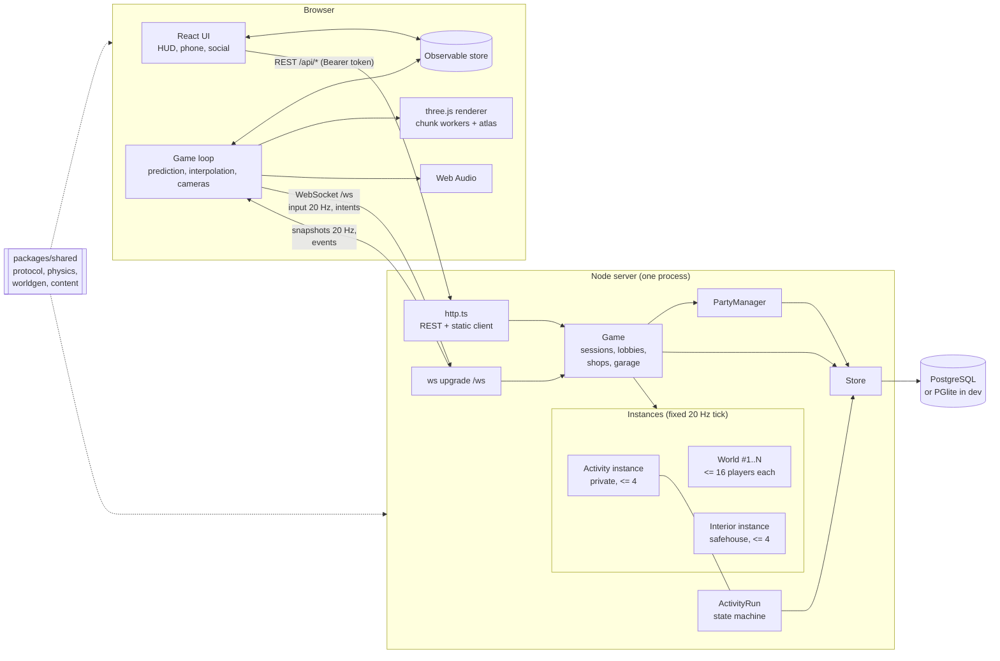

# Architecture

This document describes what the code does today. Where something is planned but
not built, it says so.

## 1. Stack and why

| Layer | Choice | Reason |
| --- | --- | --- |
| Language | TypeScript everywhere (npm workspaces: `packages/shared`, `apps/server`, `apps/client`) | One set of types and one protocol definition shared by client and server. The server runs TypeScript directly through `tsx`; there is no server build step. |
| UI | React 19 (HUD, menus, phone, social) | Overlay UI on top of the canvas. State lives in a small observable store (`state/store.ts`) that the game loop writes at about 10 Hz so React never renders at frame rate. |
| Renderer | three.js (WebGL2) voxel renderer | Chunks are generated and meshed in Web Workers (`render/chunkWorker.ts`, `render/mesher.ts`), with per-vertex ambient occlusion and an emissive flag baked into the vertex data. Block textures are painted procedurally into a padded 16x16 tile atlas at start-up (`render/atlas.ts`), so there are no texture files. Optional bloom post-process. |
| Physics | Custom shared deterministic code (`packages/shared/src/physics.ts`) | Player movement and vehicle dynamics run over voxel collision (solid-block lookups plus a few AABB door colliders). The identical functions (`stepPlayer`, `stepVehicle`) run on the server (authoritative) and in the browser (prediction), so a general physics engine was not used: engines are not bit-for-bit deterministic across both environments, and the world is a static voxel grid where a custom solver is simple and cheap. |
| Server | Node.js 22+, `ws` WebSocket library, built-in `http` | Authoritative simulation and REST API on one port. No web framework. |
| Validation | `zod` | Every client-to-server WebSocket message and every REST body is schema-validated before use. |
| Database | PostgreSQL (`pg` pool) in production; PGlite (PostgreSQL compiled to WASM) in development and tests | Same SQL and same migrations on both. PGlite removes the need to install a database for development. |
| Audio | Web Audio API, no library (`audio/index.ts`) | Buses for music, sfx, voice and radio, with ducking. |

World data is deterministic: `getWorldGen(PALMARA)` produces identical blocks on the
server (collision, ground height) and in client workers (rendering and prediction)
from the same map data and seed. The world is static; there is no block editing.
Because of that, the server never sends terrain; the client regenerates it.

## 2. Responsibility split

| Concern | Where | Notes |
| --- | --- | --- |
| Rendering, input, camera, audio | `apps/client/src/{render,game,audio}` | Sends inputs and intents; never decides outcomes. |
| Authoritative simulation | `apps/server/src/world/instance.ts` and helpers (`npc.ts`, `police.ts`, `entities.ts`) | Movement, vehicles, weapons and damage, NPC traffic and pedestrians, police and wanted levels, interaction holds, doors, snapshots. |
| Account and social REST | `apps/server/src/http.ts`, `store.ts` | Register/login/logout, friends, blocks, privacy, reports, settings, health, credits, admin. |
| Party and session coordination | `apps/server/src/social/parties.ts`, `game.ts` (`Session`, `Game`) | Parties (1-4 players, invite or expiring link), who is in which instance, presence, lobbies, chat routing. |
| Activity instances | `apps/server/src/activities/runner.ts`, `lobby.ts` | One generic state machine (`ActivityRun`) runs any `ActivityDef`; the lobby handles briefing, readiness, heist plan, payout split. |
| Persistence | `apps/server/src/store.ts`, `db/` | Accounts, sessions, social graph, profiles, vehicles, runs, rewards, ledger, reports, audit log, parties. All money changes are transactions with a ledger row. |
| Content definitions | `packages/shared/src/content/` | Pure data: map, POIs, activities, cutscenes, shop prices, weapons. Prices and rewards are applied only on the server. |

The server does not trust the client for position beyond input: the client sends
movement inputs (axes, yaw, pitch, jump/sprint, throttle/steer/handbrake), the server
simulates them. Purchases, rewards, damage, interaction range and hold timers, vehicle
ownership and seat assignment are all decided server-side.

## 3. Component diagram

## 4. Instance model

An `Instance` (`world/instance.ts`) is a self-contained simulated copy of the world:
players, vehicles, NPCs, mission objects, doors, plus an optional `ActivityRun`.
All instances share one static voxel cache (`world/voxels.ts`, LRU of 1600 chunks).

| Kind | Capacity | Created when | Closed when |
| --- | --- | --- | --- |
| `world` | 16 (`MAX_PLAYERS_PER_INSTANCE`), counting reserved link-dead slots | At server start (first world), on `world.join` with target `new`, or when `auto` finds no world with room. Labelled `Palmara #n`. | Empty for over 60 s while at least one other world exists (housekeeping, every 5 s), or an admin closes it. |
| `activity` | 4 | When the lobby leader launches an activity. Private to the roster; the crew is teleported to the activity start. Traffic and pedestrians run only if the activity allows them. | When the run ends (complete, abandoned, everyone left). Players are returned to their previous world position. |
| `interior` | 4 | When a player uses their apartment door at The Coquina. The owner and their party members share one interior. | When it is empty (housekeeping) or an admin closes it. |

Notes:

- Free-roam worlds are capped at `MAX_INSTANCES` (default 40) when creating a new one
  via `world.join` `new`. Activity and interior instances are not counted against that cap.
- `world.join` targets: `auto` (party member's world first, otherwise the fullest world
  with room, otherwise a new one), `party`, `new`, or an explicit instance id.
- Only The Coquina (safehouse) uses an interior instance. Every other enterable
  building in downtown Port Solano is a walk-in shell inside the shared world
  instance, with a few locked doors. See [MAP.md](MAP.md).
- All instance state is in memory. A server restart discards every instance, lobby,
  NPC and wanted level (see section 12 and [DATA_MODEL.md](DATA_MODEL.md)).
- The server is a single process. There is no cross-process instance sharing or
  horizontal scaling; running two server processes would give two separate
  populations that share one database.

## 5. Fixed-step server tick (20 Hz)

`TICK_RATE = 20`, `DT = 0.05 s`. `Game.start()` runs a self-correcting loop built on
`setTimeout`: it keeps a `next` deadline, runs up to 4 catch-up ticks per wake-up, and
re-synchronises if it falls more than 1 s behind. Each tick calls `Instance.tick()` for
every instance sequentially, with exceptions caught per instance. Per tick an instance:

1. consumes queued player inputs (each processed input advances that player's physics by exactly one `DT` step),
2. steps unoccupied vehicles (rolling to a stop),
3. moves vehicle occupants with their vehicle,
4. runs NPC systems (traffic and pedestrians in worlds; police and wanted logic),
5. resolves dynamic collisions and interaction holds, respawns downed players, auto-closes doors,
6. ticks the `ActivityRun` if present,
7. builds and sends one snapshot to every connected player.

Tick cost (EMA average and decaying maximum, in ms) is exposed by `/api/health`.

## 6. Client prediction, reconciliation and interpolation

Local player (`client/src/game/game.ts`):

1. The client runs a fixed 20 Hz step (`DT`, accumulator, at most 5 steps per frame).
   Each step it reads the input, sends `{t:'input', seq, ...}`, and immediately applies
   the same `stepPlayer` (on foot) or `stepVehicle` (driver, seat 0) the server uses.
   Unacknowledged inputs are kept in a `pending` list (capped at 120).
2. When a snapshot arrives it carries `ack` (the last input `seq` the server processed)
   and `me`, the authoritative physics state. The client drops acknowledged inputs,
   takes the server state, and **replays the remaining pending inputs** on top of it.
3. The replayed result is compared with the current predicted position. On foot, an
   error above 4 blocks (or any vehicle transition) snaps; smaller errors are added to
   a `visualErr` offset that decays exponentially (about 10 per second) so corrections
   are smooth. For vehicles, an error above 6 blocks snaps.
4. Rendering interpolates between the previous and current fixed step (`alpha`).
5. Cutscenes and the downed state freeze local stepping.

Server side the input queue per player is capped (30, trimmed to 20) and drained at 2
inputs per tick, or 3 when more than 6 are queued, so a lagging connection catches up.

Remote entities: each snapshot entity is stored with the snapshot's server `time`. The
renderer draws remote players, vehicles and NPCs at `serverNow - 110 ms`
(`INTERP_DELAY`) by interpolating between the two surrounding samples. `serverNow` is
derived from a clock offset that is refined by `ping`/`pong` every 2 s
(`offset = serverTime + rtt/2 - localTime`). Entities that did not change keep their
last sample.

The 24-minute day/night cycle (`DAY_LENGTH_S = 24*60`) is derived from server time, so all
clients agree on the time of day.

## 7. Interest management and delta compression

Per snapshot (`Instance.snapshot`):

- Center point: the player's position (or the cutscene focus point during a cutscene).
- Radius: `INTEREST_RADIUS = 200` blocks, horizontal distance only.
- Players, vehicles and NPCs outside the radius are not sent. Exceptions: party members
  are always sent while online (so map markers work); a vehicle you own is always sent;
  activity vehicles are sent to the crew.
- Mission objects and doors are sent without a radius filter (instances hold few of them).
- Delta compression: for each client the server remembers the JSON string last sent for
  every entity id (`PlayerEnt.sent`). An entity is included in a snapshot only when its
  serialised form changed (positions are rounded to 2 decimals). Entities that dropped
  out of view or were removed are listed in `gone`.
- The player's own `me` state is sent every tick.
- Transport is JSON text over WebSocket with `perMessageDeflate` disabled. There is no
  binary encoding yet.

## 8. Vehicle seat authority

- Each vehicle has `seats` slots (`occ[]`); **seat 0 is the driver**.
- `veh.enter` is validated on the server: distance (`VEHICLE_ENTER_RANGE` plus half the
  vehicle length), downed/frozen state, ownership (`allowed` set), police vehicles are
  locked, a requested seat must be free (otherwise the first free seat is used).
- Only the seat-0 occupant's inputs drive the vehicle (`throttle`, `steer`, handbrake
  are taken from the driver's `input` messages and applied with `stepVehicle`). Other
  occupants are carried: their position follows the seat offset every tick.
- The driver also receives authoritative vehicle state (`me.vp`) for prediction;
  passengers see the vehicle as a normal interpolated entity.
- Personal vehicles (from the garage) may be entered by the owner and the owner's party
  (`vehicleAllowed`, refreshed when the party changes). Taking a traffic car makes the
  AI driver bail and can add a wanted level.
- Exiting at more than 12 m/s (non-boats) is refused. When a driver leaves (or
  disconnects), the vehicle's input is reset to "handbrake on" and it coasts to a stop.
  There is **no automatic seat promotion**: passengers stay seated, and one of them can
  take the wheel by sending `veh.enter` with `seat: 0` for the same vehicle.
- A player who disconnects while in a vehicle is force-exited (placed beside it) and
  marked link-dead.

## 9. Rate limits

All are token buckets (`ratelimit.ts`); values are `capacity` burst, then refill per second.

| Scope | Limit | On exceed |
| --- | --- | --- |
| WebSocket: all messages, per `ip + userId` | 90 burst, 60 per s | Message dropped; after 200 drops the socket closes with code 4008 |
| WebSocket: messages failing zod validation | counter, not a bucket | Closed with 4008 after 50 |
| WebSocket: message size | over 4096 chars: error reply; the `ws` server `maxPayload` is 8 KB | Hard close by the library above 8 KB |
| WebSocket: chat (and `ping.mark`, key `userId:ping`) | 5 burst, 1 per s | Notice to the player |
| WebSocket: `act.brief`, `act.lobby`, `act.launch`, `shop.buy`, `garage` | 20 burst, 4 per s per user (shared bucket) | Silently ignored |
| WebSocket: hello after connect | must arrive within 10 s | Closed with 4004 |
| REST: all `/api/*`, per IP | 120 burst, 20 per s | HTTP 429 |
| REST: login, per IP and per username | 10 burst, 10 per minute each | HTTP 429 |
| REST: register, per IP | 5 per hour in production (60 in development) | HTTP 429 |
| REST: social/party/report/privacy writes, per user | 30 burst, 1 per 2 s | HTTP 429 |
| REST: request body | 32 KB | HTTP 413 |

Client-to-server messages are all validated by the `C2S` zod union
(`packages/shared/src/protocol.ts`). The server also normalises chat (control
characters stripped, 200 chars).

## 10. Reconnection grace

- When a socket closes, the player is marked link-dead: the entity is hidden from
  others, input is cleared, held interactions are cancelled, and the slot stays
  reserved (it still counts toward capacity). The player's position is saved to the
  database.
- Reconnecting (a new `hello` with a valid session token) re-attaches to that
  entity, wherever it is (world, activity or interior), resends world and activity
  state, and tells the player they are back in the activity.
- How long a slot is held:
  - Free-roam world: 45 s (hard-coded in `Game.housekeeping`).
  - Interior: `RECONNECT_GRACE_MS` = 90 s.
  - Activity: per roster member, `RECONNECT_GRACE_MS` = 90 s. When everyone has
    been gone for longer than that, the run is abandoned. A roster member who is
    absent too long is dropped from the run; nobody new can join a running activity
    (`lateJoin` is `roster_reconnect` or `never`).
- The browser client reconnects automatically with exponential backoff
  (500 ms doubling to 10 s, plus up to 400 ms jitter) unless the close code is 4003
  (client out of date) or 4004 (kicked, banned, session expired, or signed in
  elsewhere).
- A second login for the same account closes the older socket with 4004.

## 11. Activities, lobbies and cutscenes in one paragraph

A party leader opens a lobby (`act.lobby`); readiness, heist approach, equipment
(max 2), roles and payout split (each at least 10%, summing to 100) are agreed there
and frozen into the run at launch. Launch creates a private `activity` instance,
moves the crew to the start spot and starts an `ActivityRun`, which walks the
definition's stages: optional cutscene (server owns timing; clients report
`cs.loaded`, with a bounded wait of 8 s, and vote to skip), spawns, objectives, fail
conditions, checkpoints. Completion computes rewards and calls
`Store.grantReward`, which is idempotent per `(run_id, user_id)`. The content
format is described in [DATA_MODEL.md](DATA_MODEL.md).

## 12. Server restart behaviour

Graceful stop (`SIGINT`/`SIGTERM`, `Game.shutdown`):

1. stop the tick loop and housekeeping timer,
2. save each player's position (and dirty ammo) and mark every active run
   `interrupted`,
3. write each owned vehicle back to storage with its current health (`state='stored'`),
4. close all sockets with code 4001 (`Server restarting`); the client shows a notice
   and reconnects automatically.

Start-up (`Game.init`), which also covers a hard crash where step 2-3 never ran:

1. every `activity_runs` row still `active` becomes `interrupted` (it can never pay out),
2. every vehicle with `state='out'` becomes `stored`,
3. parties updated within the last 6 hours are restored from the `parties` table
   (pending invites and share links are cleared; chat history keeps the last 30 lines),
4. one fresh free-roam world is created.

What survives: accounts, sessions, cash, rep, completions, unlocks, heist preps,
mission checkpoints, inventory, outfit, last saved position, vehicles, personal bests,
parties. What is lost: all live instances, lobbies, wanted levels, NPCs and
unsaved progress inside an interrupted activity (no reward is granted for an
interrupted run; the leader's mission checkpoint, saved at each checkpoint stage, is
kept so a mission can be resumed from there). Positions are saved on disconnect, on
using the bed, on leaving a world, and roughly every 30 s while playing in a world.
