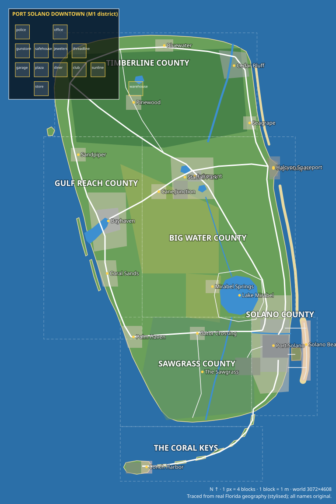
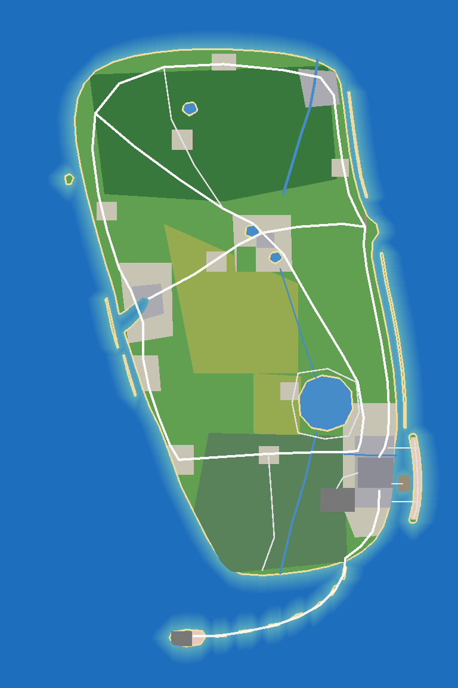
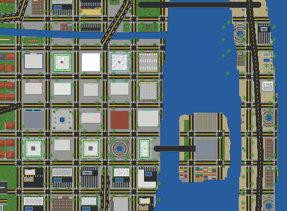

# Palmara map

> **Default world.** Since 2026-11-18 the game runs on **Leonia** (true-scale real Miami, docs/LEONIA.md)
> by default; Palmara is selected with `BLOCKSHORE_WORLD=palmara` / `?world=palmara`. Content is authored in
> Palmara coordinates and moved onto Leonia at load (docs/LEONIA.md §10). Leonia locations of the
> enterable buildings: section 10 below.

Palmara is the fictional Florida-like state VICE CRAFT is set in. The map is plain
data in `packages/shared/src/content/map/palmara.map.ts` (type `MapData`,
`packages/shared/src/world/mapTypes.ts`). A deterministic generator
(`world/worldgen.ts`) turns it into blocks, identically on the server and in the
client's chunk workers.

## 1. Provenance: traced from real Florida, not from a game map

The geography is a stylised tracing of **real Florida geography**: a peninsula with
a large lake in the interior, a sawgrass wetland to the south, a curved island chain
off the southern tip, Atlantic barrier islands, a dense south-east metro and a bay
city on the Gulf coast.

The project owner originally supplied a fan-made map of another game's fictional
state. That map was deliberately **not reproduced**: a game's map is that game's
level design, and copying it would copy someone else's creative work. Instead the
real-world geography was used as the reference, simplified and renamed. Every place
name is original; the real-world analogues below are for orientation only.

## 2. Scale and coordinate system

| Property | Value |
| --- | --- |
| Unit | 1 block = 1 m |
| Axes | `x` increases east, `z` increases south. **North is -z.** `y` is up. |
| World bounds | `x` 0 to 3072, `z` 0 to 4608 (`PALMARA.width`, `PALMARA.depth`) |
| World height | 128 blocks (`WORLD_H`) |
| Sea level | block `y = 20` (the water top surface is at `y = 21`) |
| Flat ground | feet height `y = 22` (`GROUND_Y`); the top block of flat land is `y = 21` |
| Chunk size | 16 x 16 columns (`CHUNK`) |
| Yaw | yaw 0 looks toward -z (north); forward vector is `(-sin yaw, -cos yaw)` |
| Seed | `1977` (`PALMARA.seed`) |

The map is heavily compressed compared with the real state. For scale: Cedar Bluff
to Port Solano is about 2.6 km on this map, against roughly 500 km between the real
cities that inspired them. Distances and travel times are tuned for gameplay, not for
realism.

## 3. Images

Generated by `npm run map:overlay` (see section 8).

### Annotated overview (`map-overlay.svg`)

Land, water, zones, roads, counties, places and points of interest.

### Whole-state preview (`map-preview.png`)

Rendered from the real generator rasters, 1 px = 4 blocks.

### Downtown Port Solano (`downtown-topdown.png`)

Full-detail top-down render, 1 px = 1 block.

## 4. Places and their real-world analogues

Analogues marked (given) were specified by the project owner. Marked (editorial) are
the nearest sensible reading by position and role, chosen while writing this
document; they are not stated anywhere in the code.

| Palmara | Kind | Map coordinates (x, z) | Analogue |
| --- | --- | --- | --- |
| Port Solano | city (main playable city) | 2500, 3160 | Miami (given) |
| Solano Beach | district, resort barrier island | 2800, 3150 | Miami Beach (editorial) |
| Bayhaven | city | 990, 2020 | Tampa (given) |
| Cedar Bluff | city | 2140, 600 | Jacksonville (given) |
| Lakemont | city (suburbs plus a small urban core) | 1780, 1610 | Orlando (given) |
| Cape Halcyon | landmark, industrial zone | 2500, 1540 | Cape Canaveral (given) |
| Lake Mirabel | water (big inland lake) | 2190, 2700 | Lake Okeechobee (given) |
| The Sawgrass | wilderness (wetland) | 1850, 3400 | The Everglades (given) |
| The Coral Keys | island chain (county) | label 1700, 4120 | The Florida Keys (given) |
| Conch Harbor | town on Last Key | 1340, 4270 | Key West (editorial) |
| Coral Sands | town | 980, 2500 | Gulf-coast resort towns, e.g. Sarasota/Fort Myers area (editorial) |
| Palm Haven | town | 1220, 3080 | Naples (editorial) |
| Starfall Park | landmark in Lakemont | 1690, 1620 | an Orlando-area lake park (editorial) |
| St. Ives River | river, flows north to the sea at Cedar Bluff | 1900,1300 to 2130,400 | St. Johns River (editorial) |
| Kissing Creek | river, feeds Lake Mirabel from the north | 1880,1800 to 2120,2530 | Kissimmee River (editorial) |
| Cedar Key | small island | 430-500, 1160-1240 | Cedar Key (editorial) |
| Sandpiper Isle, Pelican Isle | Gulf barrier islands | around 700-920, 2000-2660 | Gulf barrier islands (editorial) |

Counties (labels on the map, `PALMARA.counties`): Timberline County (north, forest),
Gulf Reach County (west coast), Big Water County (centre, around the lake), Solano
County (south-east metro), Sawgrass County (southern wetland) and The Coral Keys.

Zones (`PALMARA.zones`, later entries win where they overlap) classify land for the
generator: `forest`, `farmland`, `wetland`, `suburb`, `urban`, `downtown`,
`industrial`, `airport`, `resort`. Notable ones: `timberline_forest`,
`central_farmland`, `mirabel_farms`, `sawgrass_glades`, `solano_downtown`
(x 2400-2640, z 3064-3270), `solano_urban`, `solano_suburbs`, `solano_airport`
(x 2150-2380, z 3270-3430), `solano_port` (x 2660-2756, z 3176-3300),
`solano_beach_strip`, `conch_harbor` and `last_key_airport`.

## 5. Major features

### Land and water

- `mainland` polygon plus islands: Sandpiper Isle, Pelican Isle, Cedar Key, Port Island
  (the dock island east of downtown, x 2666-2754, z 3178-3296), seven `key_*` islets
  forming a curved chain south-west of the tip, and Last Key (westernmost, x about
  1130-1390, z about 4210-4340).
- Atlantic barrier islands (`barriers`, thin strips with a width): North Banks,
  Halcyon Shore, and Solano Beach (60 wide, x about 2770-2800, z 2930-3480).
- Water bodies: Lake Mirabel, Bayhaven Bay (Gulf bay), Lake Starfall, Lake Cypress and
  Lake North.
- Rivers: St. Ives River, Kissing Creek, Solano Canal (through the city, x 2300-2660 at
  z about 3050) and Shark Slough (Glades slough).

### Highways and roads

Roads are polylines (`PALMARA.roads`) with a `kind` of `highway`, `arterial` or
`street`. Where a road crosses water the generator builds a causeway bridge. Real-world
analogue names below are editorial.

| Road | Kind | From (x, z) | To (x, z) | Analogue |
| --- | --- | --- | --- | --- |
| Coastal Highway (north part) | highway | 2150, 520 | 2544, 3060 | I-95 / US-1 |
| Coastal Highway (south part) | highway | 2544, 3290 | 2316, 3740 | I-95 / US-1 |
| Overseas Causeway | highway | 2316, 3740 | 1300, 4262 | Overseas Highway (US-1) to the Keys |
| Sunstate Turnpike | highway | 640, 760 | 2400, 3020 | Florida's Turnpike |
| North Loop | highway | 640, 760 | 2150, 520 | north coast route |
| Gulf Highway | highway | 640, 760 | 1200, 3080 | I-75 |
| Cross-Glades Highway | highway | 1200, 3080 | 2400, 3020 | Alligator Alley |
| Bayhaven Interstate | highway | 1000, 2000 | 2450, 1520 | I-4 |
| Mirabel Lake Road | arterial (loop) | around 2000, 2500 | - | lake ring road |
| Flamingo Causeway | arterial | 2604, 3000 | 2800, 3000 | Miami causeways to Miami Beach |
| Tarpon Causeway | arterial | 2632, 3360 | 2804, 3360 | Miami causeways to Miami Beach |
| Port Bridge | arterial | 2630, 3240 | 2700, 3240 | PortMiami bridge |
| Ocean Drive | arterial | 2780, 2950 | 2776, 3470 | Ocean Drive / Collins Ave |
| Airport Road | arterial | 2400, 3168 | 2260, 3270 | - |
| Airboat Road | arterial | 1800, 3040 | 1760, 3820 | Everglades airboat roads |
| Pinewood Road | arterial | 1100, 450 | 1500, 1400 | - |

Inside urban-type zones (`suburb`, `urban`, `downtown`, `industrial`, `resort`) the
generator lays out a procedural street grid: `streetGrid = { spacing: 48, roadWidth: 8,
sidewalk: 3 }`. Street intersections are every 48 blocks, and each 48x48 cell is a
"lot" (`LOT = 48`).

### Bridges

Causeway bridge decks are generated wherever a road crosses water. Notable crossings:
Flamingo Causeway and Tarpon Causeway (mainland to Solano Beach), Port Bridge (to Port
Island) and the Overseas Causeway (along the Keys chain). See the limitations in
section 7: the decks are flat and sit on the water surface.

## 6. Enterable buildings and activity locations (Port Solano downtown)

Points of interest are defined in `packages/shared/src/content/pois.ts`. A POI occupies
one lot `[i, j]`, which spans world `x = 48i ... 48i+47` and `z = 48j ... 48j+47`
(centre = `48i+24, 48j+24`). Building shells come from prefabs in
`world/structures.ts`.

| POI | Lot [i, j] | x range | z range | Centre (x, z) | What it does today |
| --- | --- | --- | --- | --- | --- |
| The Coquina (apartment) | [51, 65] | 2448-2495 | 3120-3167 | 2472, 3144 | Player safehouse. Door at the front uses a private interior instance (owner plus party). Bed (rest, heal, save), wardrobe (shirt colour), heist planning board, TV (random news line). |
| Solano Plaza | [51, 66] | 2448-2495 | 3168-3215 | 2472, 3192 | Downtown square. New arrivals spawn at 2472, 22, 3204. |
| Torque & Tide Garage | [50, 66] | 2400-2447 | 3168-3215 | 2424, 3192 | Service desk and mechanic Dez: repair, paint, store/collect vehicles, buy vehicles. Vehicle spawn at 2416.5, 3173. |
| Quik Pelican | [51, 67] | 2448-2495 | 3216-3263 | 2472, 3240 | Store: snack, soda, first-aid kit (carry up to 3). |
| Sunny Side Diner | [52, 66] | 2496-2543 | 3168-3215 | 2520, 3192 | Food counter; **Marisol Reyes** (contact, jobs) in the corner booth at 2517.5, 3183.5. |
| Neon Lagoon | [53, 66] | 2544-2591 | 3168-3215 | 2568, 3192 | Nightclub: bar (alcohol-free drink), bouncer, **DJ Kilo** (racing jobs) at 2567.5, 3204.5. |
| Solano PD, Central Precinct | [50, 64] | 2400-2447 | 3072-3119 | 2424, 3096 | Front desk: pay a fine to clear a wanted level (not while being chased). Players who are "busted" respawn here. |
| Vega & Sons Imports | [52, 64] | 2496-2543 | 3072-3119 | 2520, 3096 | Office with reception; the private office door is locked. Flavour only. |
| Sundial Jewelers | [52, 65] | 2496-2543 | 3120-3167 | 2520, 3144 | Target of the Sundial heist (and its scouting prep). |
| Pier 9 Warehouse | [56, 67] | 2688-2735 | 3216-3263 | 2712, 3240 | Dockside warehouse on Port Island. Both doors (loading shutter, side door) are locked in free roam; the interior is built (office, catwalk) but no finished content uses it yet. |
| Bullseye Arms (gun store) | [50, 65] | 2400-2447 | 3120-3167 | 2424, 3144 | Weapon and ammo shop (clerk Rico); counter at the `shop:gunstore` anchor. Sells pistol, SMG, shotgun and carbine plus ammo packs. Added to the content just before this document was finalised; confirm it in game. |
| Threadline (clothing, barbers) | [53, 65] | 2544-2591 | 3120-3167 | 2568, 3144 | Boutique plus Fade Away Barbers. Shop definitions (`clothes`, `barber`) exist in `economy.ts`; hair colour is stored as an inventory item (`hair:<hex>`). |
| Sunline Motors (showroom) | [54, 66] | 2592-2639 | 3168-3215 | 2616, 3192 | Car showroom with a sales desk using rule `shop:dealer`. **No `dealer` entry exists in `SHOPS` yet**, so the desk currently answers "Closed."; vehicles are bought in the Torque & Tide garage menu. |

### Activities and where they start

Positions are world coordinates (`y = 22`). Source: `content/activities.ts`, plus
`content/story.ts`.

| Activity id | Name | Giver | Start (x, z) | Unlock | Notes |
| --- | --- | --- | --- | --- | --- |
| `story_1` | Welcome to Port Solano | Marisol | 2472, 3204 | available to new accounts | Meet Marisol at the diner (2519.5, 3184), drive the Dart Hatch, collect packages at 2405.5/3246.5, 2549.5/3110.5 (plus two more for bigger parties), deliver to the garage (2416.5, 3186), walk to The Coquina (2471.5, 3127). Reward $1500 and 100 rep; unlocks the items below. |
| `prep_sundial_scout` | Sundial Prep: Case the Joint | Lena | 2512, 3112 | after `story_1` | Photograph three spots around Sundial Jewelers (timed). |
| `prep_sundial_wheels` | Sundial Prep: Getaway Wheels | Lena | 2470, 3160 | after `story_1` | Steal the Vireo GT parked on Ocean Drive (2797, 3150), lose the police, park it at the garage (2430.5, 3186). |
| `heist_sundial` | The Sundial Job | Lena | 2464, 3134 (crew starts at 2526-2535, 3162) | after `story_1`; both preps first | Quiet or loud approach, two keypads, safe, display cases, getaway; the drop is Pier 9 at 2712, 3214. |
| `race_downtown` | Downtown Sprint | DJ Kilo | 2560, 3160 (grid at 2430-2440, 3166-3170) | after `story_1` | Two laps, nine checkpoints around the downtown grid; solo medals or head-to-head. |

More activities were added to `content/story.ts`, `content/heists.ts` and
`content/minigames.ts` by other engineers while this documentation was being written.
They are listed here from the code at that moment; **the content is still in flux and
`npx tsx scripts/validate-content.ts` reported about 22 errors (cutscene cameras or end
spots inside solid blocks)**, so treat everything below as unfinished until the validator
is clean.

| Activity id | Name | Giver | Start (x, z) | Requires |
| --- | --- | --- | --- | --- |
| `story_2` | Cold Chain | Marisol | 2519.5, 3175.5 | story_1 |
| `story_3` | Repo Season | Dez | 2430, 3174 | story_2 |
| `story_4` | Neon Warm-Up (race) | Kilo | 2568, 3174 | story_3 |
| `story_5` | Pier 9 After Dark | Nix | 2471.5, 3221.5 | story_4 |
| `story_6` | Heat Index | Marisol | 2519.5, 3175.5 | story_5 |
| `story_7` | Dead Reckoning | Barney | 2827.5, 3243.5 | story_6 |
| `story_8` | Open Books | Marisol | 2519.5, 3175.5 | story_7 and heist_sundial |
| `prep_pier9_recon`, `prep_pier9_keys`, `prep_pier9_skiff` | Pier 9 preps | Nix / Grebe / Barney | 2693.5, 3222.5 and 2670.5, 3202.5 | story_5 |
| `heist_pier9` | The Pier 9 Shuffle | Lena | 2693.5, 3222.5 | heist_sundial and story_5 |
| `prep_tower_plans`, `prep_tower_convoy`, `prep_tower_boat` | Tower preps | Nix / Lena / Barney | 2517.5, 3077.5; 2567.5, 3223.5; 2670.5, 3202.5 | heist_pier9 |
| `heist_tower` | The Vega Tower Job | Lena | 2517.5, 3077.5 | heist_pier9 and story_7 |
| `mini_trial` | Palm Mile Time Trial (race) | Kilo | 2597.5, 3196.5 | story_3 |
| `mini_taxi` | Sunline Cab Co. | Marisol | 2448.5, 3172.5 | story_2 |
| `mini_delivery` | Palm Parcel Rush | Dez | 2471.5, 3221.5 | story_2 |
| `mini_boatrace` | Lagoon Cup (race) | Barney | 2635.5, 3103.5 | story_6 |
| `mini_range` | Bullseye Range | Dez | 2710.5, 3209.5 | story_2 |

`story_7` starts at the Solano Beach side (2827.5, 3243.5) and has a stage that arrives in
Conch Harbor on Last Key (its `conch_arrival` cutscene is placed around x 1370, z 4295).

Cutscenes (camera tracks are played by the client; the server owns timing and skip
votes) live in `content/cutscenes.ts` (`arrival`, `diner_meet`, `garage_dez`,
`sundial_intro`, `race_intro`) and, for the newer missions, `content/cutscenes2.ts`.

## 7. Inferred and simplified

- **No panhandle.** The real state's western panhandle is not modelled. Palmara is the
  peninsula only.
- **Heavy scale compression** (section 2). Cities are small and close together.
- **Causeway bridges are flat.** A road crossing water becomes a deck: concrete placed
  in the water column at `y = 20`, road surface at `y = 21` (the water surface height),
  rails on the edges and piers every 24 blocks. There is no clearance below the deck,
  so **boats cannot pass under roads** and a causeway acts as a wall for water traffic.
  Road elevation changes and drawbridges are not implemented.
- **Interiors exist only in downtown Port Solano.** The thirteen POIs above are the only
  buildings with designed interiors. Every other city and town (Bayhaven, Cedar Bluff,
  Lakemont, Conch Harbor and so on) is generated procedurally from its zone: lots become
  towers, mid-rises, houses, warehouses, hotels or parks (`LotKind` in `worldgen.ts`).
  Those buildings are not enterable, and the cities have no named shops, contacts or
  activities.
- Only Port Solano has designed activity content. Bayhaven, Cedar Bluff, Lakemont and
  the Keys are traversable terrain with roads and procedural buildings.
- The Pier 9 Warehouse and the Vega & Sons office are present but their doors are
  locked outside of specific content.
- Cape Halcyon has a launch complex (landmarks, section 9) but no activity content.
- The jewelry store's blurb says "closed after dark"; that is not implemented. Its
  front door uses the rule name `shop_hours`, which has no handler, so the door behaves
  like a normal door in free roam.
- Boat delivery is not implemented: the garage refuses to deliver boats
  ("coming soon"), and there is no marina. A boat can be bought, but collecting it uses
  the garage's single land spawn point, so it appears on dry ground at the garage.
- The 12 glTF models in `apps/client/public/models` (cars, boat, palm tree, street lamp,
  bench, traffic light) are listed with licenses; at the time of writing only
  `render/entities/inspect.ts` loads `.glb` files, and the entity renderer was being
  written by another engineer, so how much of the world uses them is not documented here.

## 8. Editing the map and regenerating the overlay

1. Edit `packages/shared/src/content/map/palmara.map.ts`. It is pure data:
   `land` (closed polygons, clockwise), `barriers` (polyline plus width), `water`
   (lake or sea polygons carved out of land), `rivers` (polyline plus width), `zones`
   (polygons; later wins), `roads` (polylines), `counties` and `places` (labels) and
   `streetGrid`. Coordinates are `[x, z]` in blocks.
2. To add or move a building, edit `packages/shared/src/content/pois.ts` (lot index and
   prefab name) and the prefab in `packages/shared/src/world/structures.ts`.
3. Restart the server and rebuild or reload the client. Both rebuild the world from the
   same data, so there is nothing to export. Changing terrain moves ground height: check
   that spawns, activity positions and cutscene cameras still sit on valid ground by
   running `npx tsx scripts/validate-content.ts` (exit code 1 on errors).
4. Regenerate the documentation images with `npm run map:overlay`. It writes
   `docs/map-overlay.svg`, `docs/map-preview.png` and `docs/downtown-topdown.png`.
5. Keep this document's tables in sync by hand; they are not generated.

Because any change to `PALMARA` changes the generated blocks, deploy client and server
together. A client built from a different map version would predict collisions that the
server disagrees with. There is no map version number in the protocol today (the
`PROTOCOL_VERSION` check only covers message shape).

## 9. Regions, landmarks and the country between (2026-11)

Every column belongs to a **region** (`world/regions.ts`, `RegionRaster`), taken from the zone
polygon id (later zones win) plus two region-only areas (the spaceport grounds and the Coral Keys).
Each region has its own palette and lot mix; lots are no longer all-or-nothing: the generator
finds the largest road-free rectangle of each lot and picks a building type that fits it, never
repeating a special type next to its west/north neighbour.

| Region | Look |
| --- | --- |
| Port Solano downtown | glass curtain-wall towers (teal/blue/gold/dark), setbacks, roof gardens, helipads, spires, parking garages, cranes |
| Port Solano midtown | mid-rises with murals and awnings, apartments with balconies, strip malls, diners, gas stations, courts, food trucks, motels |
| Port Solano suburbs | pastel stucco houses with tile roofs and pools, schools, mission churches |
| Solano Beach | art-deco hotels (pastel, eyebrows, stepped crowns, vertical neon name fins), beach clubs with cabanas, condos, umbrellas |
| Port Island | warehouses and container yards |
| Bayhaven | red-brick rows with awnings and iron balconies, cigar factories (clock tower, water tank, smokestack), port cranes, container ship |
| Cedar Bluff | limestone/brick shops with slate roofs, stone churches with copper spires, town hall, riverside promenade |
| Lakemont | cul-de-sacs, ranch houses, ponds; core: main-street shops, town hall; Starfall Park |
| Coral Sands / Palm Haven | Mediterranean villas around pool courtyards, golf holes with bunkers and flags, condos |
| Cape Halcyon | launch pads, assembly building, radar dome and dish, bunkers |
| Conch Harbor / Keys | wooden conch houses with porches and tin roofs, stilt cottages, docks, bait shacks, mangroves |
| Sawgrass | pools, stilt houses, airboat docks, boardwalks, palm hammocks, cypress with moss, ranger station |
| Timberline | longleaf/spruce/pine/mossy oak forest, granite + mossy outcrops in the north, cabins, campsites, lumber mill, fire lookout |
| Farmland | 64-block fields of cane, citrus groves (orange-dotted leaves), corn, vegetables, pasture with hay; farmsteads with red barns and silos; sugar mill |
| Small towns | Pinewood, Cane Junction, Gator Crossing, Sandpiper, Mirabel Springs, Bluewater, Seagrape: houses, shops, gas, diners, motels, churches, a named water tower |

Landmarks (`world/landmarks.ts`, built once and replayed per chunk):

| Landmark | Position (x, z) |
| --- | --- |
| Starfall Park (castle keep to y 111, ferris wheel, coaster, drop tower to y 120, carousel, kiosks, gate) | 1588-1716, 1652-1820 |
| Cape Halcyon: rocket + gantry pad, assembly building, radar | pad 2512, 1497; VAB 2470-2500, 1528-1572 |
| Halcyon Shore pad 2 | 2612, 1975 |
| Cedar Bluff river bridge towers | 2116, 513 |
| Bayhaven port cranes x3 + container ship | east bay shore, z 2028 / 2058 / 2088 |
| Conch Harbor lighthouse / sunset pier | 1364, 4238 / 1318, 4318-4362 |
| Lake Mirabel fishing pier + bait shop | west shore, z 2700 |
| Welcome to Palmara sign (Sunstate Turnpike) | 783, 855 |
| Solano International terminal, tower, hangars, planes | 2160-2372, 3270-3356 |
| Last Key airfield | 1196-1246, 4231-4249 |
| Timberline fire lookout | 1916, 958 |
| Pinewood lumber mill | 1186, 812 |
| Palmara Sugar mill | 1528, 1762 |
| Sawgrass ranger station | 1834, 3238 |
| WPAL radio mast (to y 121) | 1660, 2160 |
| Town water towers | see `TOWN_TOWERS` |

Between the regions: highway guard rails (gaps at junctions and driveways), roadside stops every
~210 blocks of highway/arterial (billboards with original brands, gas stations, rest areas, citrus
stands, gator-tour signs), beaches with dunes and sea oats, lifeguard towers and umbrellas, coastal
piers, lake docks with boats, mangroves along the southern shores, seagrass and coral reefs on
shallow floors, wildflower meadows, palmetto understory, runway lights. Scatter never touches the
Port Solano metro, the Conch Harbor arrival or the story_7 boat legs (`PROTECT_RECTS` /
`PROTECT_LEGS` in worldgen.ts); lots that hold mission spots are forced to open kinds (`KEEP_LOTS`).

Top-downs of every area: `docs/topdown/*.png` (`npm run map:overlay`). 3D views: open
`/?preview&at=x,y,z,lookx,looky,lookz`; `window.__bs.at(...)` / `__bs.step()` drive it manually.

## 10. The same buildings on Leonia (real Miami addresses)

On Leonia every POI is a placement frame (lot-centre world position + quarter turns; see
docs/LEONIA.md §10.1). Businesses keep their fictional names; streets and districts are real.

| POI | District | Street | lat, lon | World x, z | Faces |
|---|---|---|---|---|---|
| The Coquina (safehouse) | Downtown | NE 3rd Street | 25.77733, −80.19170 | 13871, 13590 | south |
| Bayfront Plaza (spawn) | Downtown | Biscayne Blvd, Bayfront Park | 25.77498, −80.18705 | 14337, 13850 | west |
| Torque & Tide Garage | Downtown | NE 1st Avenue | 25.77635, −80.19227 | 13814, 13698 | east |
| Quik Pelican | Downtown | SE 1st Street | 25.77369, −80.18940 | 14101, 13993 | south |
| Sunny Side Diner | Downtown | NE 2nd Avenue | 25.77676, −80.19008 | 14033, 13653 | west |
| Leonia PD — Central Precinct | Downtown | NW 3rd Avenue | 25.77922, −80.19931 | 13108, 13381 | west |
| Neon Lagoon | Wynwood | NW 2nd Avenue | 25.80169, −80.19938 | 13101, 10891 | east |
| Bullseye Arms | Wynwood | NW 22nd Street | 25.79788, −80.20409 | 12628, 11313 | north |
| Vega & Sons Imports | Brickell | SW 10th Street | 25.76421, −80.19489 | 13551, 15043 | north |
| Sundial Jewelers | Brickell | South Miami Avenue | 25.76420, −80.19348 | 13692, 15045 | east |
| Pier 9 Warehouse | PortMiami (Dodge Island) | cargo yard road | 25.77267, −80.16271 | 16778, 14106 | north |
| Threadline | South Beach | Euclid Avenue | 25.77853, −80.13530 | 19527, 13457 | east |
| Sunline Motors | South Beach | 5th Street | 25.77405, −80.13803 | 19254, 13953 | north |

Activity geography on Leonia: Pier 9 → Dodge Island cargo yard; Solano Beach / Ocean Drive → South Beach Ocean Drive;
Solano Airfield → MIA hangar apron off NW 36th Street; Conch Harbor / Last Key → Virginia Key Beach (by boat round
South Pointe and through Norris Cut); the lagoon → Biscayne Bay off Bayfront Park. Races: Downtown Sprint (NE 1st Ave –
Flagler – Biscayne Blvd – NE 5th St), Neon Warm-Up (Wynwood block of the club), Palm Mile (South Beach ring: Alton Rd,
17th St, Collins Ave, Ocean Drive, 5th St), Lagoon Cup (buoys off Bayfront Park).
